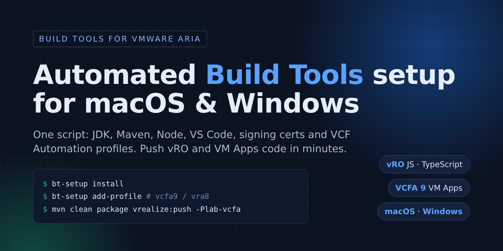

# Build Tools for VMware Aria – automated setup

Scripts that set up a workstation for [Build Tools for VMware Aria](https://github.com/vmware/build-tools-for-vmware-aria)
and push vRO (JavaScript / TypeScript) and VCF Automation VM Apps projects.

| Folder | Platform |
|---|---|
| [`mac/`](mac/) | macOS – install, connection profiles, project scaffolding, self-test, full usage guide |
| [`windows/`](windows/) | Windows 10/11 – PowerShell 5.1+, no admin rights, same commands |

## Quick start

| | macOS | Windows |
|---|---|---|
| Install everything | `./bt-setup.sh install` | `powershell -ExecutionPolicy Bypass -File .\bt-setup.ps1 install` |
| Add a VCF Automation / vRA target | `./bt-setup.sh add-profile` | `.\bt-setup.ps1 add-profile` |
| Create a project | `./bt-setup.sh new-project` | `.\bt-setup.ps1 new-project` |
| Check everything | `./bt-setup.sh doctor` | `.\bt-setup.ps1 doctor` |
| Push (in the project folder) | `mvn clean package vrealize:push -P<profile>` | same |

**Next: [Getting started](docs/getting-started.md)** – setting up VS Code, pushing your first project, what each
project type (JS, XML, mixed, TypeScript, VM Apps) gives you, and where to find the pushed content in
Orchestrator and VCF Automation.

Built on [Build Tools for VMware Aria](https://github.com/vmware/build-tools-for-vmware-aria) and the
[vRealize Developer Tools](https://github.com/vmware/vrealize-developer-tools) VS Code extension.
